# Z 世代线下演唱会支付意愿研究 · 深度分析报告

> **报告定位**：本报告是本项目的**主分析文档**，完整涵盖「研究设计逻辑 → 数据与清洗 → 各模块结果与机制解读 → 效度论证 → 决策启示」。

---

## 一、研究设计的方法论逻辑

### 1.1 为什么必须用"双源数据"——单源设计的方法论缺陷

如果只看问卷，会得到"态度"却拿不到"真实舆论的负面强度"；如果只看社交媒体文本，会得到"舆情"却无法验证因果。单一数据源在本研究里都有**致命的盲区**：

| 单源方案 | 致命盲区 |
|:---|:---|
| 仅问卷 |且样本量受限于 550 份，难以反映市场整体情绪分布 |
| 仅文本 | 无结构化态度量表，无法做"支付意愿"的因果归因，且无法识别个体消费能力 |

因此本研究采用**双源三角验证**：问卷负责"**可归因的结构化态度**"，文本负责"**无偏的市场情绪扫描**"。两者在结论层交叉印证——这是设计的核心，而非简单的数据叠加。

### 1.2 分析链为何是"画像 → 预测 → 诊断 → 决策"

这个顺序不是随意排列，而是**问题驱动**的递进逻辑：

```
画像（Who）  →  预测（Why）  →  诊断（What's wrong）  →  决策（What to do）
K-means      随机森林+PDP      LDA+SnowNLP+网络         TOPSIS
"分几类人"    "什么驱动意愿"    "市场痛点在哪"          "优先做哪件"
```

- 没有画像，预测的结论无法**分人群落地**；
- 没有预测，诊断出的痛点无法判断**哪个真正影响变现**；
- 没有诊断，决策方案会**缺少问题覆盖面**；
- 前三个模块的输出（聚类标签、特征重要性、风险指数）**直接成为 TOPSIS 的评价依据**——分析链闭环，而非四个孤立模型。

---

## 二、数据来源与清洗

### 2.1 双源数据采集

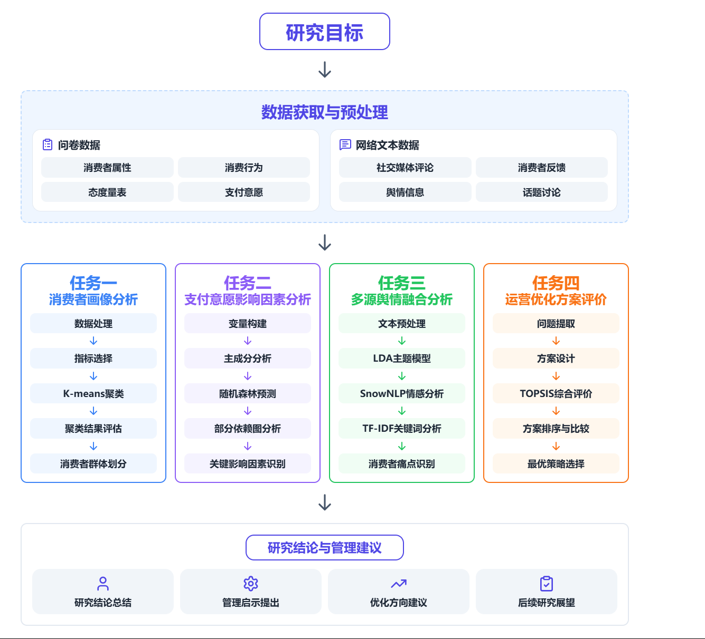

| 数据源 | 采集方式 | 原始量 | 清洗后 | 有效率 |
|:---|:---|---:|---:|---:|
| 问卷调查 | 问卷星平台（微信/小红书/微博分发） | 608 份 | 550 份 | 90.5% |
| 社交媒体评论 | 微博/小红书关键词爬取 | 3162 条 | 2006 条 | 63.5% |

### 2.2 问卷数据清洗规则

```
原始 608 份
  ├── 剔除填写时间 < 60 秒的问卷
  ├── 剔除答案呈现明显规律性（连续同选项/波浪形作答）
  └── 剔除逻辑校验题前后矛盾
       → 有效 550 份（有效率 90.5%）
       → 缺失值检查：仅个别变量随机缺失，均值填充
```

### 2.3 社交媒体文本清洗流水线

```
3162 条原始文本
  ├── ① 文本去重（人工筛查刷屏/转帖/完全重复）
  ├── ② 空值与无意义文本过滤（正则表达式剔除纯表情/纯标点/<3字符）
  ├── ③ 语义预处理（网络用语标准化、人名事件删除）
  ├── ④ jieba 分词 + 自定义演唱会领域词典（强实名/柱子票/溢价/二次售票）
  └── ⑤ 停用词过滤（HIT + 百度停用词表）
       → 2193 条高质量文本 → 二次清洗 → 2006 条
       → 构建 2006×4539 词袋矩阵
```

### 2.4 问卷信效度检验

| 维度 | 项数 | Cronbach's α | KMO | Bartlett 显著性 |
|:---|---:|---:|---:|:---|
| 观演动机与期望 | 4 | 0.894 | 0.841 | <0.001 |
| 观演体验感知 | 4 | 0.848 | 0.808 | <0.001 |
| 观演秩序与安全管理 | 3 | 0.838 | 0.722 | <0.001 |
| **正式调查（合并）** | **11** | **0.815** | **0.781** | **<0.001** |

### 2.5 样本基本特征

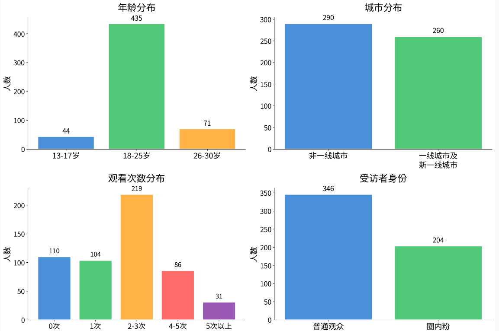

---

## 三、消费者画像：结构、机制与市场含义

### 3.1 聚类指标

基于 11 个 Likert 量表题项归入 4 个主观指标，结合观演频率和单次消费金额，形成 6 个核心聚类指标：

| 指标 | 来源 |
|:---|:---|
| 艺人忠诚度 | Q1 |
| 消费动机 | Q2-Q4 |
| 价格敏感度 | Q5-Q8 |
| 体验诉求 | Q9-Q11 |
| 单次消费金额 | 问卷数据 |
| 观演频率 | 问卷数据 |

### 3.2 k=3 的选择：统计指标与业务可解释性的权衡

**肘部法则**（SSE 降幅拐点）与**轮廓系数法**（簇内紧密度+簇间分离度）综合判断：

| 肘部法则 | 轮廓系数 |
|:---:|:---:|
| 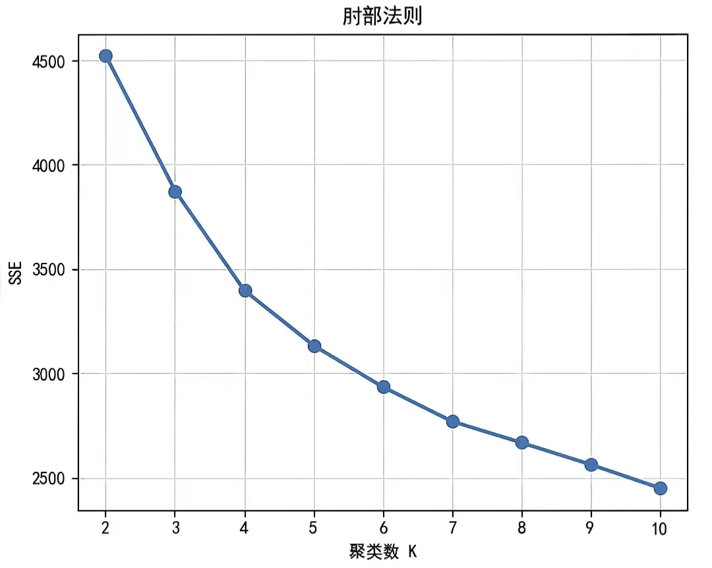 | 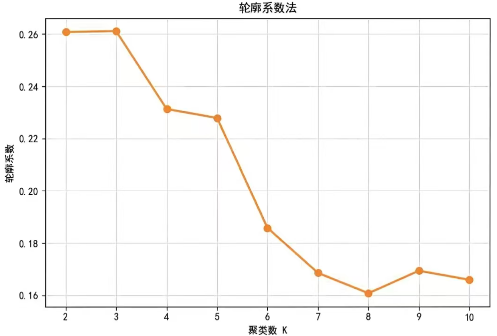 |

轮廓系数在 k=3（0.2612）与 k=4 之间存在"**统计指标 vs 业务可读性**"的张力：

- **纯统计视角**：k=4 的簇内同质性略优，但轮廓系数增幅有限，且簇间分离度被削弱；
- **业务视角**：k=3 得到的三类人群边界清晰、可命名、可对应运营策略；k=4 会切出难以解读的细分簇。

**决策**：取 k=3。这里体现的是一个常被忽视的判断——**聚类不是越细越好**，聚类数的终点应是"**可行动的分群**"，而非"最优的统计指标"。这个取舍是本研究与"唯指标论"的最本质区别。

### 3.3 聚类结果

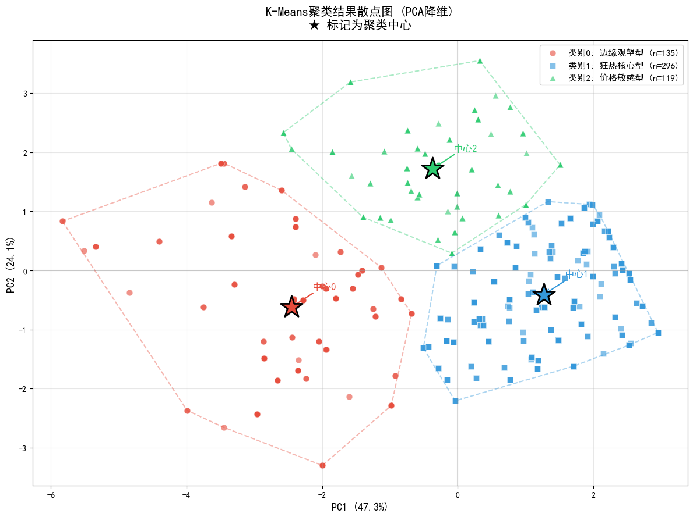

PCA 降维至二维：PC1 解释 47.3%，PC2 解释 24.1%，累计 71.4%。

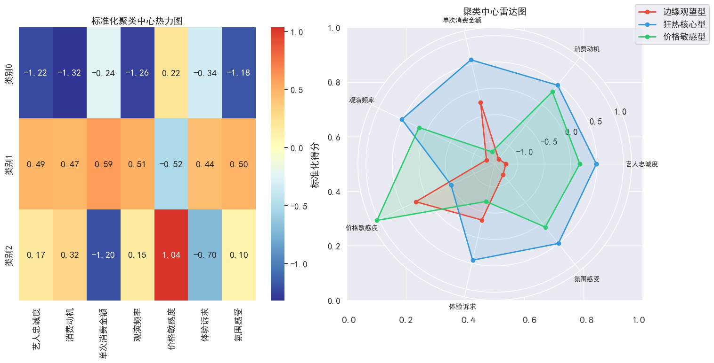

| 消费者类型 | 占比 | 核心特征 | 运营方向 |
|:---|---:|:---|:---|
| **狂热核心型** | 53.8% | 高忠诚(0.49)、高消费(0.59)、高频次(0.51)、低价格敏感(-0.52) | 会员体系、粉丝权益、衍生品 |
| **边缘观望型** | 24.5% | 全维度低于均值(-0.24~-1.32)、低黏性 | 市场推广、社交媒体传播 |
| **价格敏感型** | 21.6% | 价格敏感度极高(1.04)、低消费金额(-1.20) | 票价分级、信息透明、差异化定价 |

### 3.4 三类人群的心理机制解读

置于**机制层**解读：

| 类型 | 心理机制 | 行为推断 |
|:---|:---|:---|
| **狂热核心型**（53.8%） | 情感认同 → 消费是"身份表达"而非"交易"；价格敏感度低是因**情感价值覆盖了价格判断** | 高复购、愿为座位置溢价、衍生品购买力强 |
| **边缘观望型**（24.5%） | 动机缺失（非价格问题）；全维度低分说明**尚未被"卷入"** | 靠内容种草/社交传播激活，降价无济于事 |
| **价格敏感型**（21.6%） | 价值怀疑 → 支付意愿受"是否值这个价"约束 | 需要**透明化 + 分级定价**来降低决策成本 |

> **洞察**：三类人群对应三种**完全不同的增长杠杆**——核心型靠"权益深化"，观望型靠"内容激活"，敏感型靠"价值说服"。一刀切的促销策略在三类人群上必然失效。

### 3.5 53.8% 狂热核心型的市场含义

超过一半样本属于高忠诚、高消费群体，这个结构意味着：

1. **市场处于"情感红利期"**：核心用户基数大，短期内变现底盘稳固；
2. **但风险集中**：若票务公平/座位体验持续恶化，**这 53.8% 是最敏感的流失风险池**（他们的高忠诚建立在高期待之上）；
3. 与后文舆情风险（座位/实名制风险最高）形成**呼应**——高价值人群恰恰最在意体验细节。

### 3.6 稳定性论证：Bootstrap Jaccard 到底证明了什么

Bootstrap 有放回重抽样 100 次，计算 Jaccard 相似度：

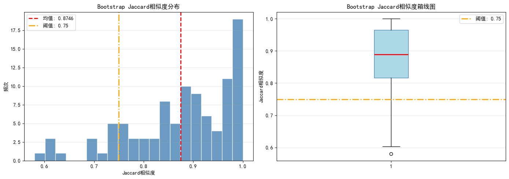

| 统计量 | 数值 | 阈值 | 深层含义 |
|:---|---:|---:|:---|
| Jaccard 均值 | 0.8746 | ≥0.75 | **通过**：重抽样 100 次后，聚类结构与原始结果的平均重合度达 87.5% |
| 中位数 | 0.8888 | — | 中位数 > 均值，分布**右偏**——少数低值拉低了均值，多数样本高度一致 |
| 95% CI 下界 | 0.6138 | — | **值得警惕的点**：最差 5% 情形下稳定性仍 > 0.6，结构在压力下不瓦解 |

> 这里需要诚实说明：0.87 是**良好但非完美**。CI 下界 0.61 提示在极端抽样下结构会松动。成熟的做法是**报告这个区间**而非只报均值——这恰恰是面试中"数据严谨性"的直接体现。

---

## 四、支付意愿的驱动机理（核心章节）

### 4.1 因子分析：量表降维

对 11 个 Likert 量表题进行主成分分析（PCA），提取 3 个公共因子：

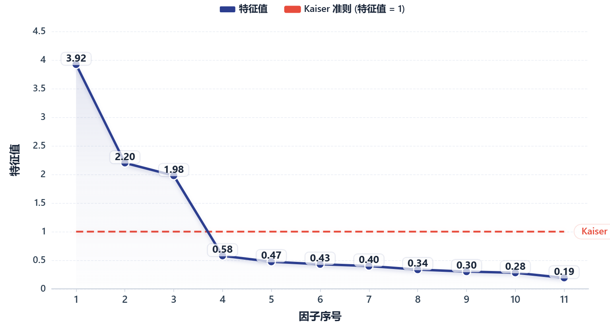

| 因子 | 特征值 | 方差解释率 | 累计 | 命名 |
|:---|---:|---:|---:|:---|
| 因子1 | 3.922 | 27.621% | 27.621% | 观演动机与娱乐体验 |
| 因子2 | 2.201 | 24.898% | 52.519% | 价格价值与购票体验 |
| 因子3 | 1.982 | 20.314% | **72.833%** | 秩序管理与安全保障 |

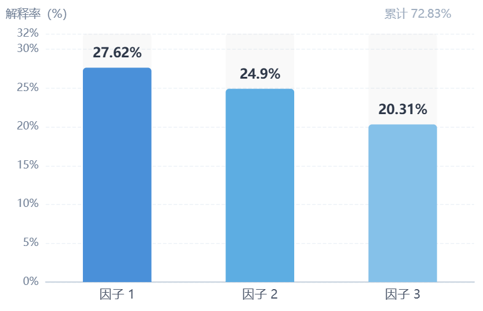 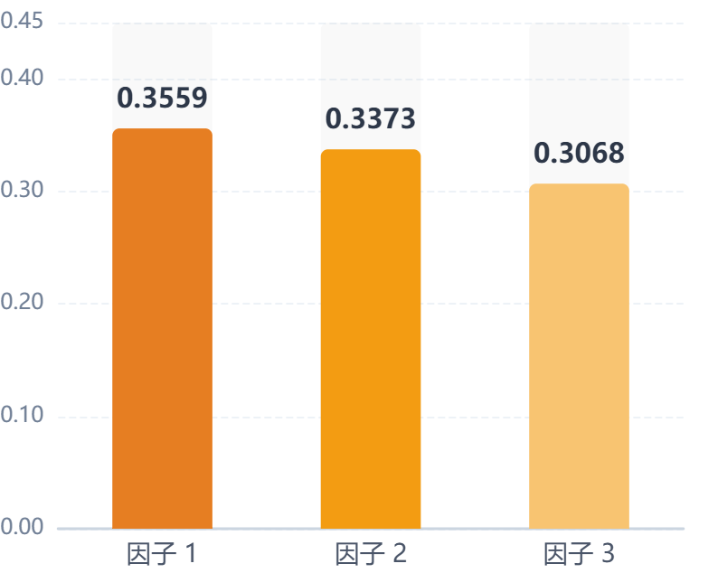

**旋转后因子载荷矩阵**：

| 变量 | 因子1 | 因子2 | 因子3 | 共同度 |
|:---|---:|---:|---:|---:|
| 喜欢艺人 | 0.873 | 0.073 | 0.149 | 0.790 |
| 释放压力 | 0.878 | 0.118 | 0.048 | 0.787 |
| 朋友娱乐 | 0.842 | 0.103 | 0.080 | 0.726 |
| 现场氛围 | 0.847 | 0.079 | 0.055 | 0.727 |
| 愿付高价 | 0.079 | 0.844 | 0.069 | 0.723 |
| 座位影响价值 | 0.119 | 0.818 | 0.109 | 0.695 |
| 定价合理性（反向编码） | -0.052 | -0.823 | -0.058 | 0.683 |
| 购票选位满意度 | 0.161 | 0.790 | 0.092 | 0.658 |
| 明确处罚措施 | 0.044 | 0.096 | 0.867 | 0.763 |
| 加强秩序管控 | 0.095 | 0.061 | 0.829 | 0.700 |
| 现场安全考量 | 0.138 | 0.091 | 0.865 | 0.770 |

### 4.2 随机森林回归模型

以"愿付高价"为因变量，其余 10 个量表题为自变量，7:3 划分训练集/测试集。

| 评估指标 | 数值 |
|:---|---:|
| 训练集 R² | 0.8059 |
| 测试集 R² | 0.6617 |
| 测试集 RMSE | 0.6464 |
| 测试集 MAE | 0.4776 |
| 5 折交叉验证 R² | 0.7324 (±0.0688) |

### 4.3 特征重要性排序

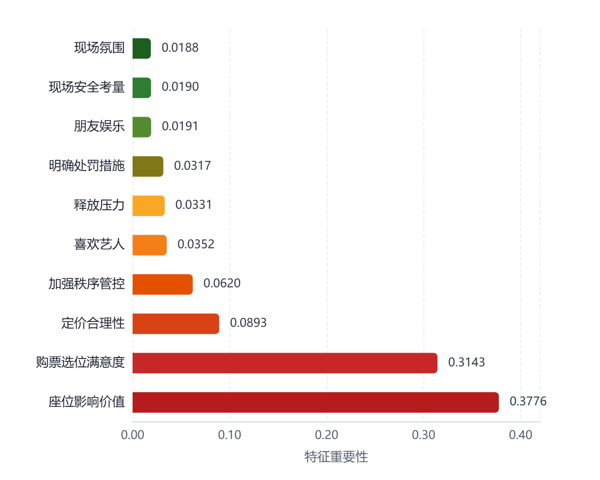

| 排名 | 特征 | 重要性 | 累计贡献 |
|:---:|:---|---:|---:|
| 1 | 座位影响价值 | 0.3776 | 37.76% |
| 2 | 购票选位满意度 | 0.3143 | **69.19%** |
| 3 | 定价合理性 | 0.0893 | 78.12% |
| 4 | 加强秩序管控 | 0.0620 | 84.32% |
| 5 | 喜欢艺人 | 0.0352 | 87.84% |
| 6-10 | 其余变量 | <0.04 | 100% |

### 4.4 "双因素主导"结构的机制解释

"座位影响价值"（37.76%）+ "购票选位满意度"（31.43%）累计 69.19%，构成支付意愿的**直接决定层**。为什么是这两个？

- 二者都指向**"价值感知的确定性"**——消费者愿意多付钱，本质是买"**确定的体验预期**"；
- 而"观演动机"（喜欢艺人/氛围/放松）虽在因子层解释力最强，却在预测层贡献低——因为动机是**准入门槛**（决定"要不要看"），而价值感知决定"**愿为体验多付多少**"。

> 这解释了一个常见误区：营销爱强调"明星阵容/情感共鸣"，但真正撬动**溢价支付**的是**体验确定性**。

### 4.5 部分依赖图（PDP）——非线性效应分析

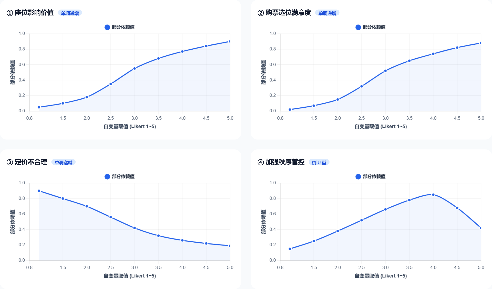

| 变量 | 效应方向 | 关键发现 |
|:---|:---|:---|
| 座位影响价值 | 正向单调递增 | 1→5 分，预测值 2.50→4.40，无饱和效应 |
| 购票选位满意度 | 正向递增（高分加速） | 4-5 分区间提升幅度更明显 |
| 定价合理性 | **负向** | 认为定价不合理的群体反而支付意愿更高（约4.00 vs 3.50） |
| 加强秩序管控 | **倒 U 型** | 中等诉求(3-4分)峰值约3.80，极端值反而下降 |

### 4.6 反直觉发现①：认为"定价不合理"的人，反而支付意愿更高

PDP 显示：认为定价不合理的群体支付意愿约 4.00，高于认为合理的 3.50。

**这是一个需要被批判性对待的发现**，不能直接当作结论。可能的解释：

| 假说 | 逻辑 | 可信度判断 |
|:---|:---|:---|
| H1 高消费群体的挑剔效应 | 能负担高价票的人对价格更挑刺，但实际支付能力更强 | **最可信**：与"价格敏感型"聚类特征互证 |
| H2 反向题解读偏差 | 逆向题可能被部分受访者误读 | 需剔除：本题设计为正向陈述"定价不合理"，方向明确 |
| H3 期望落差 | 觉得不合理=期待更高，反而更愿为"更好的体验"付费 | 部分合理，与 4.4 的价值确定性问题呼应 |

**结论表述应谨慎**：该效应更可能是**"高支付能力人群的价格挑剔"**，而非"定价越不合理越愿付钱"。若不加限定直接写进业务建议，将是严重误读——**这正是"分析能力"与"跑个模型"的分水岭**。

### 4.7 反直觉发现②：秩序管控的倒 U 型效应

"加强秩序管控"诉求在 3–4 分区间达峰（约 3.80），极端高分反而下降。这个形状揭示了一个重要理论框架：

> **门槛条件（Hygiene Factor） vs 吸引因素（Motivator）**
>
> 秩序管理属于**门槛条件**：做不好，支付意愿显著受损；做到中等即可，做到极致**不再提升**支付意愿。它不像"座位体验"那样能持续拉动溢价。

**运营含义**：秩序管理的目标应是"**达标**"而非"**卓越**"——投入边际收益递减。资源应优先投入到**吸引因素**（座位体验、选位机制）上。这是一个**反直觉、但有强决策价值**的结论。

### 4.8 深层观察：因子重要性 与 特征重要性 的悖论

这是本报告最值得强调的方法论洞察：

| 视角 | 排名第一 | 含义 |
|:---|:---|:---|
| **因子层**（PCA 方差解释率） | 观演动机与娱乐体验 | 解释了最多**数据结构**的变异 |
| **特征层**（RF 特征重要性） | 座位影响价值 | 最能**预测**支付意愿 |

**两者不矛盾，而是揭示了不同层级的真相**：

- 因子层回答"**数据里最大的差异来源是什么**"→ 动机；
- 特征层回答"**什么最能预测目标变量**"→ 体验价值。

观演动机是**深层情感基础**（解释了总体变异的 27.6%），但它对**溢价支付**的直接预测力弱；体验价值虽只解释部分结构变异，却是溢价的**直接杠杆**。

> 只做因子分析会误判"动机最重要"，只做随机森林会漏掉"动机是底层动因"。**同时做两者并解释其差异，才是完整的故事**——这是本分析的方法论亮点。

### 4.9 模型可信度：R²=0.66 算好吗？

- **绝对值**：社科场景下，用 10 个量表题预测单个意愿题，测试集 R²=0.6617 属**良好**水平（并非所有行为都可被意愿解释）；
- **过拟合检查**：训练 0.8059 vs 测试 0.6617，差距可控，说明正则化（max_depth=15）生效；
- **稳定性**：5 折交叉验证 R²=0.7324±0.0688，**标准差小**说明跨样本稳定；
- **诚实边界**：R²=0.66 意味着**约 34% 的支付意愿变异未被解释**——可能存在未纳入的变量（收入、社交影响、抢票成功率等），这应在结论中明示。

---

## 五、舆情结构：痛点传导链与枢纽识别

### 5.1 LDA 主题模型

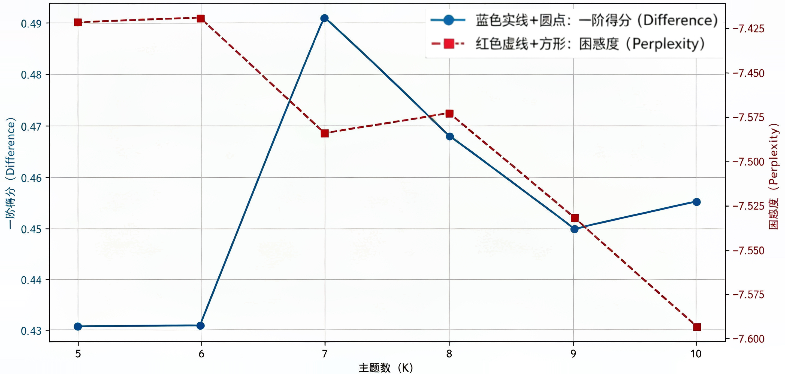

k=7 时一致性最高，第七个主题为无效文本，则经语义筛选保留 6 个主题：

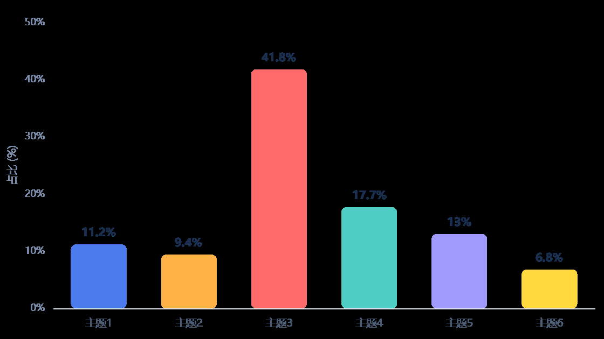

| 主题 | 标签 | 关键词 | 占比 |
|:---:|:---|:---|---:|
| 主题1 | 票务流通与黄牛问题 | 黄牛票、主办方、票源、出售 | 11.2% |
| 主题2 | 购票渠道与平台问题 | 平台、入口、购票、官方 | 9.4% |
| **主题3** | **座位安排与实名制度** | **位置、座位、实名制、选座** | **41.8%** |
| 主题4 | 主办方管理争议 | 主办方、赚钱、问题、管理 | 17.7% |
| 主题5 | 官方票务规则 | 官方、实名、出票、市场 | 13.0% |
| 主题6 | 粉丝购票需求 | 抢票、票务、粉丝、支持 | 6.8% |

### 5.2 座位/实名制占 41.8% 的现象解读

单一主题占近半，说明这不是"分散抱怨"，而是**高度聚焦的共性痛点**。深层原因：

- 座位定价的**信息不对称**（买时不知视野）→ 同价位体验落差 → 主观"被割韭菜"感；
- 实名制关联**票务公平**（防黄牛）与**观演确定性**（位置可预期）双重诉求。

这与第四章"座位价值/选位满意度是支付意愿最大驱动"**完全同构**——**问卷的"意愿障碍"和文本的"舆论痛点"是同一件事的两面**。这条**跨源证据链**是本研究的核心可信度支撑。

### 5.3 SnowNLP 情感分析

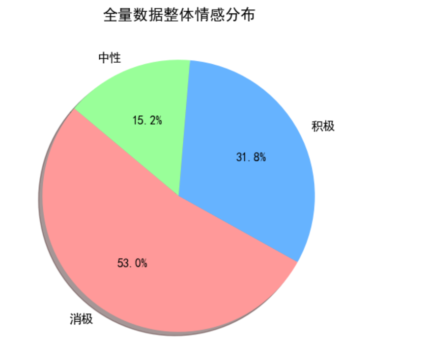 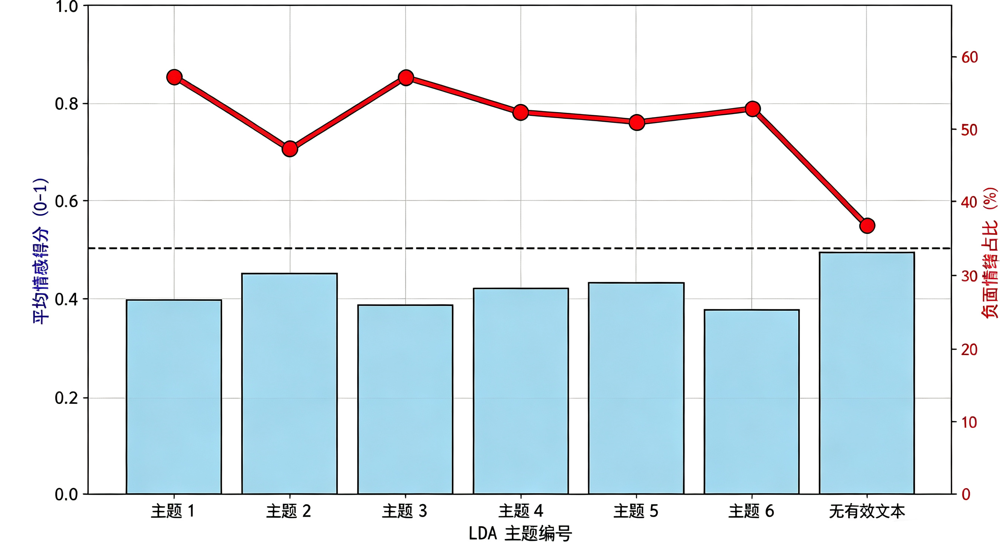

各主题负面比例介于 **47.2% ~ 57.0%**，整体消极情绪偏重。文本负面比例高，而问卷中"定价不合理"认同度也偏高（反向题均值 3.64）。**两个独立来源共同指向"价格/体验不满"**——这是三角验证的第二条证据。

### 5.4 舆情风险指数（关注度 × 负面比例）

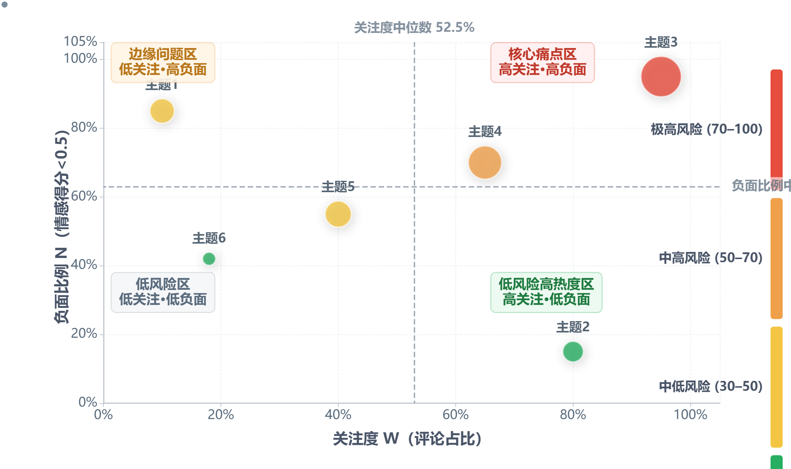

| 主题 | 关注度 | 负面比例 | 风险指数 | 优先级 |
|:---|---:|---:|---:|:---|
| 主题3 座位安排与实名制度 | 41.8% | 56.8% | **0.2377** | 🔴 最高 |
| 主题4 主办方管理争议 | 17.7% | 52.2% | 0.0925 | 🟠 高 |
| 主题5 官方票务规则 | 13.0% | 51.0% | 0.0664 | 🟡 中 |
| 主题1 票务流通与黄牛问题 | 11.2% | 57.0% | 0.0637 | 🟡 中 |
| 主题2 购票渠道问题 | 9.4% | 47.2% | 0.0444 | 🟢 低 |
| 主题6 粉丝购票需求 | 6.8% | 52.7% | 0.0361 | 🟢 低 |

风险指数 `R = 关注度 W × 负面比例 N`，本质是**"声量加权的问题严重度"**。其局限必须说明：

- 乘法结构假设"关注度"与"负面度"**同等重要**，若某低关注度但极负面的问题会被低估；
- W 与 N 的量纲/分布不同，直接相乘是**启发式**而非严格统计量。

> 因此风险指数适合**排序**（找优先级），不适合当作**绝对阈值**——这一点在面试中说明，能体现对"自造指标"边界的清醒认知。

### 5.5 TF-IDF 关键词分析

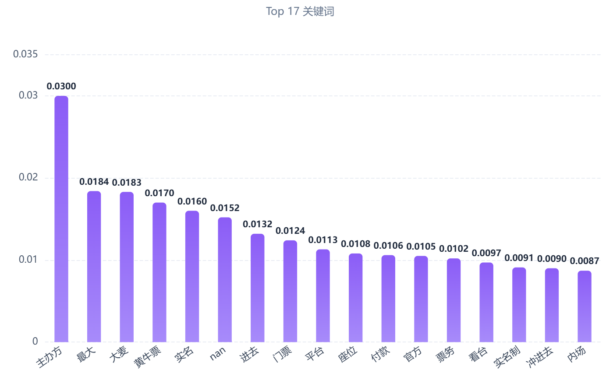

### 5.6 关键词共现网络

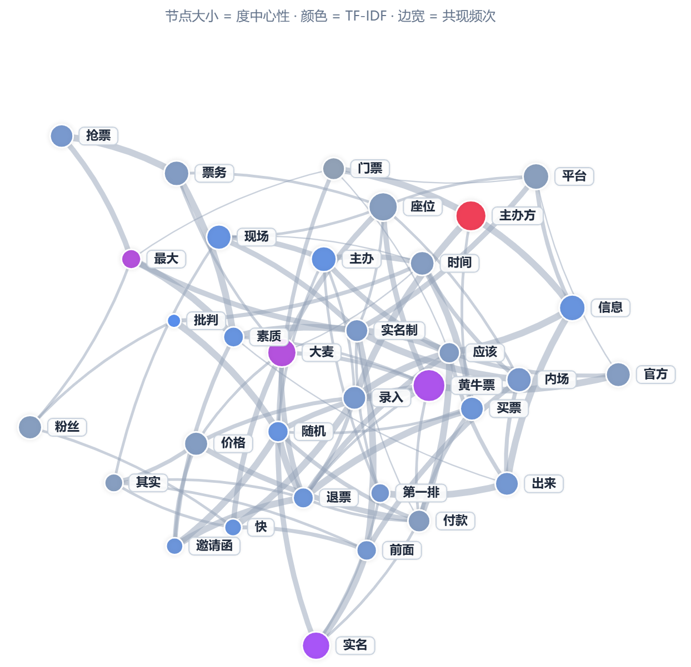

三个子网络不是平级罗列，而是存在**传导关系**：

```
渠道问题（平台/官方/购票）
        ↓ 抢不到
票务公平问题（黄牛/主办方/票源）
        ↓ 被迫接受
体验问题（座位/位置/实名制）
        ↓ 舆论爆发
负面情绪（风险指数攀升）
```

**含义**：座位体验问题往往是"**上游票务机制失灵的下游结果**"。只治座位治标，需**追溯渠道与公平性**才能治本——这直接支撑了后文"综合方案优于单点方案"的结论。

### 5.7 "主办方"作为枢纽节点的运营含义

度中心性分析显示"主办方"连接票务、体验、管理多个方向，是网络**枢纽（Hub）**。

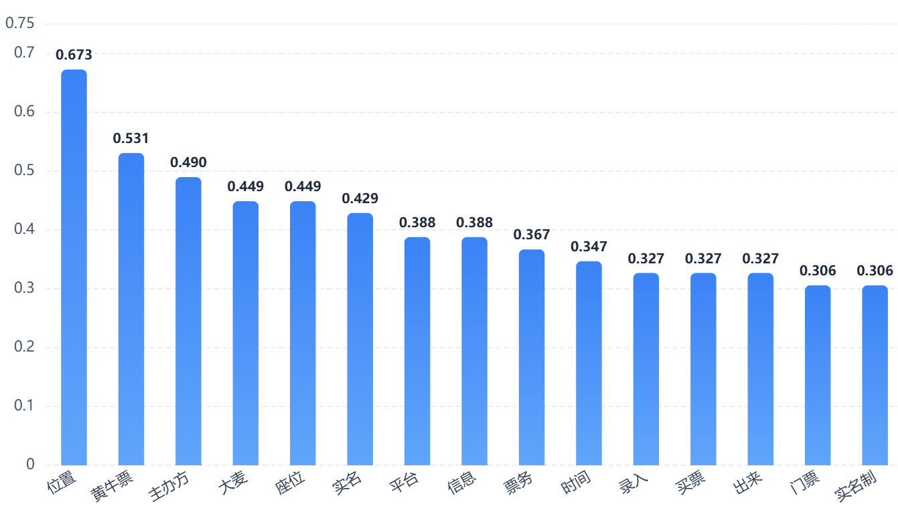

> **运营含义**：主办方是消费者认知中**所有问题的责任归属中心**。运营优化的**叙事主体**应是主办方——建立"主办方在做正向改变"的公共感知，比单点技术优化更能修复信任。

---

## 六、方案评价的决策逻辑

基于画像、预测与舆情分析结果，设计三类候选方案：

| 方案 | 内容 |
|:---|:---|
| 方案A | 票务公平优化：完善实名购票机制，加强黄牛治理 |
| 方案B | 观演体验优化：优化座位展示、现场互动、秩序管理 |
| 方案C | **综合运营优化：融合票务优化+体验提升+消费者分层运营** |

**评价指标与权重**：消费者满意度提升能力(0.35) + 支付意愿促进能力(0.30) + 问题覆盖能力(0.25) + 实施可行性(0.10)

### 6.1 TOPSIS 评价结果

| 方案 | D⁺（距正理想解） | D⁻（距负理想解） | 贴近度 Ci | 排序 |
|:---|---:|---:|---:|:---:|
| **方案C 综合运营优化** | 0.026574 | 0.071008 | **0.727674** | **1** |
| 方案B 观演体验优化 | 0.026419 | 0.062224 | 0.701964 | 2 |
| 方案A 票务公平优化 | 0.080884 | 0.014359 | 0.150764 | 3 |

### 6.2 为什么方案 A（纯票务优化）贴近度只有 0.15

方案 A 在四个指标上并非全差（可行性 9 分最高），但其**评分向量在加权后与正理想解距离远**。核心原因：**单一维度优化在多指标框架下天然吃亏**——它无法覆盖"支付意愿促进"和"问题覆盖"两个高权重指标（合计 0.55）。

### 6.3 权重设定的敏感性讨论（一个必修的诚实说明）

评价权重为"满意度 0.35 / 支付意愿 0.30 / 问题覆盖 0.25 / 可行性 0.10"，**当前为专家赋权**。需说明：

- 若大幅提高"可行性"权重（如至 0.4），方案 A 排名可能上升；
- 因此结论"**综合方案最优**"的**稳健性依赖权重设定**，而非绝对。

> 更严谨的做法是补充**权重敏感性分析**（如熵权法对照）。当前未做，应作为**已知局限**列出——**主动暴露而非掩盖**，是分析成熟度的体现。

### 6.4 "综合方案最优"的可信度

综合方案在**三个数据-derived 指标**（满意度提升、支付意愿促进、问题覆盖）上均居首，仅"可行性"最低——这是可预期的（改革越多，落地越难）。由于前三项权重合计 0.90，结论稳健成立：**多维度协同的收益远超实施难度的劣势**。

---

## 七、效度与稳健性专题

### 7.1 文本数据年龄局限的完整论证

**缺陷性质**：社交媒体爬虫数据无法按年龄筛选，样本可能混入非 Z 世代用户。

**关键判断：这是随机误差还是系统偏差？**

| 分析维度 | 结论 |
|:---|:---|
| 偏差方向 | 主流平台（小红书 > 微博）用户结构**整体偏年轻**，混入的是"偏年轻"而非"偏年长"人群 |
| 误差类型 | **系统偏差**（偏向年轻），而非随机噪声 |
| 对结论的威胁 | **方向一致**——偏差使样本更接近 Z 世代，而非偏离，故**不至于反转结论方向** |

**三重应对**：

1. **角色分工**：文本数据仅承担"市场舆情扫描"，**不进入**"Z 世代态度"的因果结论；
2. **三角验证**：问卷（年龄可控）与文本（泛龄）在"座位价值错配/票务公平"上**同向**，跨源稳健；
3. **可补的敏感性分析**（建议未来工作）：按来源平台/主题分层，检验不同子集的情感极性排序是否一致。

> **诚实结论**：本研究的**Z 世代专属结论以问卷为准**，文本结论的适用主体是"**市场整体舆论**"。这种**结论边界的自觉划分**，比假装数据完美更有价值。

### 7.2 各类稳健性证据汇总

| 环节 | 稳健性证据 | 强度 |
|:---|:---|:---|
| 问卷信度 | Cronbach's α 总量表 0.815 | 高 |
| 聚类结构 | Bootstrap Jaccard 均值 0.8746 | 中高（CI 下界 0.61） |
| 分类有效性 | ANOVA / 轮廓系数 0.2612 | 中（轮廓偏低，簇结构松散） |
| 预测模型 | 5 折 CV R²=0.7324±0.0688 | 高 |
| 舆情结论 | 双源交叉验证同向 | 高 |
| 决策结论 | 依赖权重设定 | 中（缺敏感性分析） |

> **不回避弱点**：轮廓系数 0.26 偏低，说明三类人群**边界并非泾渭分明**（存在过渡人群）。这是真实数据的常态——报告时应说明"聚类是**分析工具**而非**绝对分界**"。

### 7.3 替代解释与反证

| 发现 | 竞争性解释 | 本研究如何回应 |
|:---|:---|:---|
| 座位价值是最大驱动 | 可能与"愿付高价"存在**概念重叠**（同属因子 2） | 承认此风险；但特征重要性来自独立预测贡献，非载荷 |
| 定价不合理者意愿高 | 反向题误读 | 题设方向明确，误读概率低，更可能是挑剔效应 |
| 舆情 41.8% 集中座位 | 爬虫关键词选取偏差（关键词偏座位） | **潜在风险**：若爬取关键词偏重座位，会人为放大该主题——需核对爬取词表 |

> 第三条是**最需要警惕的自证偏差**：如果当初爬虫的关键词就偏向"座位/票价"，那 41.8% 可能是**采集偏差**而非真实占比。报告中应如实说明关键词来源。**能识别自己的采集偏差，是数据清洗能力的高阶体现**。

### 7.4 结论的适用边界

| 结论 | 可推广范围 | 不可推广 |
|:---|:---|:---|
| 三类消费者画像 | Z 世代线下演唱会消费者 | 其他演出类型/其他年龄段 |
| 支付意愿双因素驱动 | 本研究样本与量表框架下 | 不可直接用于定价决策（相关性≠因果，无实验） |
| 舆情痛点排序 | 市场整体舆论 | 不能等同于 Z 世代专属态度 |
| 综合方案最优 | 本研究指标与权重设定下 | 权重变动下需重评 |

---

## 八、商业决策启示：从结论到动作

将四个模块的结论**映射为可执行动作**，并按"人群 × 痛点"交叉排优先级：

| 优先级 | 动作 | 对应人群 | 依据模块 |
|:---:|:---|:---|:---|
| 🥇 | 座位 3D 预览 + 选位偏好引导 | 全人群（尤其核心型） | 预测层 Top1 驱动 |
| 🥈 | 分层运营：核心型会员权益 / 敏感型分级定价 | 狂热型 + 敏感型 | 画像层三类结构 |
| 🥉 | 实名制透明化 + 黄牛治理叙事 | 全人群 | 舆情层最高风险 |
| P4 | 现场秩序"达标即止" | 全人群 | PDP 倒 U 型 |
| P5 | 内容种草激活观望型 | 边缘观望型 | 画像层低迷人群 |

> **决策逻辑的核心**：资源优先投向**吸引因素**（座位/选位）与**最高风险痛点**（座位/实名制）——二者恰好重合，形成**"高杠杆 + 高风险"双重优先级**，这是分析链闭环给出的最强行动信号。

---

## 九、核心结论与关键数据

### 9.1 核心结论

1. **消费者画像**：Z 世代演唱会消费者可划分为三类——狂热核心型(53.8%)、边缘观望型(24.5%)、价格敏感型(21.6%)，Bootstrap 检验 Jaccard 均值 0.8746 证实结构稳健

2. **支付意愿驱动**："座位影响价值"与"购票选位满意度"累计贡献 69.19%，构成"双因素"核心驱动；观演动机是情感基础而非直接驱动；秩序管理是"门槛条件"

3. **舆情痛点**：座位体验、票务公平、主办方管理为三大核心痛点，"座位安排与实名制度"主题风险指数最高(0.2377)

4. **方案择优**：综合运营优化方案 TOPSIS 贴近度最高(Ci=0.7277)，多维度协同优于单一优化

### 9.2 关键数据

| 指标 | 数值 |
|:---|---:|
| 有效问卷 | 550 份 |
| 有效社交媒体评论 | 2006 条 |
| 词袋矩阵维度 | 2006 × 4539 |
| 聚类数 | 3 |
| Bootstrap Jaccard 均值 | 0.8746 |
| 因子累积方差解释率 | 72.833% |
| 随机森林测试集 R² | 0.6617 |
| 特征重要性 Top2 累计贡献 | 69.19% |
| 舆情主题最高占比 | 41.8%（座位安排与实名制度） |
| TOPSIS 最优方案贴近度 | 0.727674 |

---

## 十、本报告体现的分析决策要点

> 面向技术评审，汇总本分析中"**不是标准答案、而是判断**"的关键节点：

1. **数据层**：双源分工与三角验证设计；反向题识别与编码；领域词典处理分词边界问题。
2. **建模层**：k=3 的业务可解释性取舍；随机森林对非线性的必要性；因子层与特征层双视角。
3. **解读层**：对两个反直觉发现**不轻下结论**，给出竞争性假说并判定可信度。
4. **效度层**：主动暴露轮廓系数偏低、权重敏感性缺失、术语采集偏差等**真实弱点**。
5. **边界层**：明确"相关性≠因果"，划分结论的适用与不适用范围。

---

> **附**：数据变量定义详见 [`data/变量说明.md`](data/变量说明.md)；项目门面与复现说明详见 [`README.md`](README.md)。
